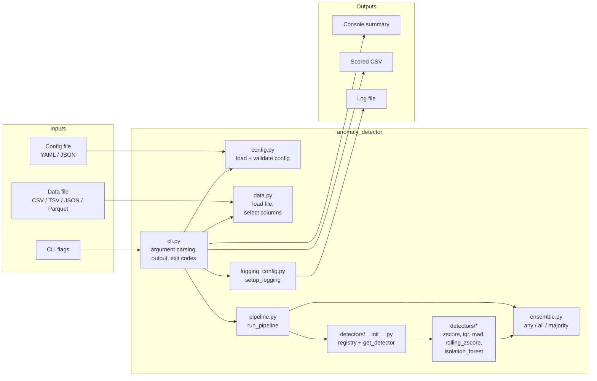

# Anomaly Detector

[](https://github.com/Anushka180712/Anomaly-Detector/actions/workflows/ci.yml)


A configurable toolkit for finding **anomalies** (outliers, unusual readings,
suspicious records) in tabular and time-series data. It ships five detection
models, combines them by voting, logs every step, and works both as a
command-line tool and as a Python library.

This README is written so that you can understand the whole project, from
what each model does mathematically to how to extend it, in a single read.

---

## Table of contents

1. [What is anomaly detection?](#1-what-is-anomaly-detection)
2. [Quick start (5 minutes)](#2-quick-start-5-minutes)
3. [Tech stack](#3-tech-stack)
4. [Architecture](#4-architecture)
5. [The models in detail](#5-the-models-in-detail)
6. [Ensemble voting](#6-ensemble-voting)
7. [Configuration](#7-configuration)
8. [Command-line reference](#8-command-line-reference)
9. [Output format](#9-output-format)
10. [Logging](#10-logging)
11. [Using it as a Python library](#11-using-it-as-a-python-library)
12. [Evaluation metrics](#12-evaluation-metrics)
13. [Sample dataset](#13-sample-dataset)
14. [Testing](#14-testing)
15. [Continuous integration](#15-continuous-integration)
16. [Extending the project](#16-extending-the-project)
17. [FAQ](#17-faq)
18. [Troubleshooting](#18-troubleshooting)
19. [Glossary](#19-glossary)
20. [License](#20-license)

---

## 1. What is anomaly detection?

An anomaly is a data point that does not look like the rest of the data: a
temperature sensor that suddenly reads 35 °C in a 20 °C room, a payment ten
times larger than a customer's usual spend, a server whose latency spikes.

Anomaly detection is usually **unsupervised**: you rarely have labels saying
which rows are bad. Instead, a model learns what "normal" looks like and gives
every row an **anomaly score**. Rows whose score crosses a **threshold** are
flagged. This project follows exactly that pattern:

```
data  ->  model learns "normal"  ->  score per row  ->  score > threshold ?  ->  flag
```

Because no single method is best for every dataset, the project runs several
models and lets them **vote**.

---

## 2. Quick start (5 minutes)

Requirements: **Python 3.10 or newer** and `git`.

```bash
# 1. Get the code
git clone https://github.com/Anushka180712/Anomaly-Detector.git
cd Anomaly-Detector

# 2. Create and activate a virtual environment
python -m venv .venv
source .venv/bin/activate          # Windows: .venv\Scripts\activate

# 3. Install the package plus development tools
pip install -e ".[dev]"

# 4. Check the installation
anomaly-detector --version
anomaly-detector list-detectors

# 5. Run all five models on the bundled sample data
anomaly-detector detect data/sample_sensor.csv \
  -c configs/default.yaml \
  --label-column is_anomaly \
  -o output/results.csv

# 6. Run the test suite
pytest
```

Expected output of step 5:

```
Rows analysed : 500
Anomalies     : 10 (2.00%)
Strategy      : majority
  - zscore             10 flagged
  - iqr                12 flagged
  - mad                10 flagged
  - rolling_zscore     12 flagged
  - isolation_forest   10 flagged
Precision 1.000 | Recall 1.000 | F1 1.000
Results written to output/results.csv
```

All 10 anomalies planted in the sample data are found with no false alarms.
Open `output/results.csv` to see the score each model gave each row.

> Prefer plain requirement files? `pip install -r requirements-dev.txt` followed
> by `pip install -e .` does the same thing. With `make` installed you can also
> use `make install`, `make test`, `make lint` and `make run`.

---

## 3. Tech stack

| Layer | Technology | Why it is used |
|-------|------------|----------------|
| Language | **Python 3.10+** | Standard language for data work |
| Numerical computing | **NumPy** (>= 1.23) | Vectorised maths for the statistical models |
| Data handling | **pandas** (>= 1.5) | Reading CSV/TSV/JSON/Parquet, rolling windows, output tables |
| Machine learning | **scikit-learn** (>= 1.2) | `IsolationForest` model and `StandardScaler` |
| Configuration | **PyYAML** (>= 6.0) | Reading YAML config files (JSON uses the standard library) |
| CLI | **argparse** (standard library) | Command-line parsing, no extra dependency |
| Logging | **logging** (standard library) | Structured, levelled logs to console and file |
| Testing | **pytest**, **pytest-cov** | Unit and end-to-end tests with coverage |
| Lint / format | **ruff** | Linting and code formatting in one fast tool |
| CI | **GitHub Actions** | Lint + tests on Python 3.10, 3.11, 3.12 and 3.13 |
| Packaging | **setuptools** via `pyproject.toml` | Installable package with an `anomaly-detector` command |

Optional: reading Parquet files needs `pyarrow` (`pip install pyarrow`).

---

## 4. Architecture

### 4.1 Component overview



### 4.2 What happens when you run `anomaly-detector detect`

```mermaid
sequenceDiagram
    actor User
    participant CLI as cli.py
    participant Log as logging_config.py
    participant Cfg as config.py
    participant Data as data.py
    participant Pipe as pipeline.py
    participant Det as detectors
    participant Ens as ensemble.py

    User->>CLI: anomaly-detector detect file.csv -c config.yaml
    CLI->>Log: setup_logging(level, log_file)
    CLI->>Cfg: load_config(path), then apply CLI overrides
    Cfg-->>CLI: validated Config
    CLI->>Data: load_data(file, timestamp_column)
    Data-->>CLI: DataFrame (sorted by time if configured)
    CLI->>Pipe: run_pipeline(df, config)
    Pipe->>Data: select_columns(df, columns)
    Pipe->>Det: get_detector(name, **params) for each entry
    Pipe->>Ens: EnsembleDetector(detectors).fit(features)
    Ens->>Det: fit(features) for each detector
    loop every detector
        Pipe->>Det: score(features)
        Det-->>Pipe: scores; flag = score > threshold
    end
    Pipe->>Ens: combine(vote matrix)
    Ens-->>Pipe: final is_anomaly_pred
    Pipe-->>CLI: DetectionResult (rows + scores + flags)
    CLI->>User: summary, optional CSV, optional precision/recall
```

### 4.3 Data flow, step by step

1. **Configure logging.** `setup_logging()` picks a level from `--log-level`,
   `-v`, `-q`, the `ANOMALY_DETECTOR_LOG_LEVEL` variable, or `WARNING`.
2. **Load configuration.** The YAML/JSON file is parsed into a `Config`
   dataclass. CLI flags such as `--detector` or `--strategy` override it.
   `Config.validate()` rejects unknown detectors or strategies early.
3. **Load data.** `load_data()` reads the file by its extension, parses and
   sorts by the timestamp column when one is configured, and logs row counts
   and missing values.
4. **Select features.** `select_columns()` keeps the configured columns (or all
   numeric columns) and checks they exist and are numeric. When a
   `--label-column` is given it is automatically excluded, so the models never
   see the answer.
5. **Build detectors.** `get_detector()` looks each name up in the registry and
   creates it with the configured parameters.
6. **Fit.** Every detector learns what "normal" looks like from the data
   (means, quartiles, medians, or a forest of trees).
7. **Score and flag.** Each detector scores every row once; a row is flagged by
   that detector when `score > threshold`.
8. **Vote.** The flags form a vote matrix (rows x detectors). The ensemble
   strategy turns it into one final decision per row.
9. **Report.** The CLI prints a summary, optionally writes a CSV and, if labels
   exist, computes precision, recall and F1.

### 4.4 Module responsibilities

| Module | Responsibility | Key objects |
|--------|----------------|-------------|
| `cli.py` | Parses arguments, wires everything together, prints results, converts errors into exit code 2 | `main()` |
| `logging_config.py` | Configures the `anomaly_detector` logger (console + optional file), resolves log levels | `setup_logging()`, `resolve_level()` |
| `config.py` | Reads YAML/JSON, normalises detector entries, validates | `Config`, `DetectorSpec`, `load_config()` |
| `data.py` | Reads data files, selects numeric columns, generates synthetic data | `load_data()`, `select_columns()`, `generate_synthetic()` |
| `pipeline.py` | Runs the full detection flow and computes metrics | `run_pipeline()`, `DetectionResult`, `evaluate()` |
| `ensemble.py` | Combines detector votes | `EnsembleDetector` |
| `detectors/base.py` | Shared interface and input handling for all models | `BaseDetector` |
| `detectors/statistical.py` | Z-score, IQR and MAD models | `ZScoreDetector`, `IQRDetector`, `MADDetector` |
| `detectors/timeseries.py` | Rolling-window model | `RollingZScoreDetector` |
| `detectors/ml.py` | Isolation Forest model | `IsolationForestDetector` |
| `detectors/__init__.py` | Registry mapping names to classes | `DETECTORS`, `get_detector()` |

### 4.5 Design decisions

- **One interface for every model.** All detectors inherit from
  `BaseDetector` and expose `fit()`, `score()`, `predict()` and
  `fit_predict()`. The pipeline never needs to know which model it is running.
- **Scores, not just flags.** Each model returns a continuous score where higher
  means "more anomalous". This keeps thresholds tunable and makes results
  explainable in the output CSV.
- **Registry pattern.** Detectors are looked up by name, so configs and CLI flags
  stay simple strings and adding a model is a two-line change.
- **Fail fast with clear messages.** Bad configs, missing columns and unknown
  parameters raise `ValueError` / `KeyError` with a readable message; the CLI
  prints it and exits with code 2.
- **Library-friendly logging.** The package only attaches a `NullHandler` on
  import, so it stays silent inside other applications until logging is
  configured.
- **Deterministic by default.** Isolation Forest uses `random_state=42`, and the
  sample data generator is seeded, so results are reproducible.

### 4.6 Project structure

```
Anomaly-Detector/
├── src/anomaly_detector/
│   ├── __init__.py           # public API, version, NullHandler
│   ├── __main__.py           # enables `python -m anomaly_detector`
│   ├── cli.py                # command-line interface
│   ├── config.py             # YAML/JSON config loading and validation
│   ├── data.py               # file loading, column selection, synthetic data
│   ├── ensemble.py           # voting across detectors
│   ├── logging_config.py     # logging setup
│   ├── pipeline.py           # run_pipeline() and evaluate()
│   └── detectors/
│       ├── __init__.py       # registry + get_detector()
│       ├── base.py           # BaseDetector interface
│       ├── statistical.py    # zscore, iqr, mad
│       ├── timeseries.py     # rolling_zscore
│       └── ml.py             # isolation_forest
├── configs/
│   ├── default.yaml          # all five models, majority vote
│   └── strict.yaml           # three models, all must agree
├── data/sample_sensor.csv    # 500-row labelled sample dataset
├── examples/quickstart.py    # runnable library example
├── scripts/generate_sample_data.py
├── tests/                    # pytest suite (one file per module)
├── .github/workflows/ci.yml  # lint + test matrix
├── Makefile                  # shortcuts: install, test, lint, run
├── pyproject.toml            # package metadata, dependencies, tool config
├── requirements.txt          # runtime dependencies
└── requirements-dev.txt      # runtime + test/lint dependencies
```

---

## 5. The models in detail

Every model below is used in the same way: it is **fitted** on the data to learn
what normal looks like, it **scores** each row (higher means more unusual), and
it **flags** rows whose score is above its `threshold`.

When the data has several columns, the statistical models score each column
separately and use the **largest** column score for the row. So a row is
unusual if *any* of its values is unusual. Missing values (NaN) are ignored
during fitting and count as "not anomalous" during scoring.

### Summary

| Model | Registry name | Type | Library | Default threshold | Best for |
|-------|---------------|------|---------|-------------------|----------|
| Z-score | `zscore` | Statistical, univariate | NumPy | 3.0 | Roughly bell-shaped data |
| Interquartile range | `iqr` | Statistical, univariate | NumPy | 1.5 | Skewed data |
| Median absolute deviation | `mad` | Robust statistical | NumPy | 3.5 | Data already containing large outliers |
| Rolling z-score | `rolling_zscore` | Time series | pandas | 3.0 | Data with trends, seasons or level shifts |
| Isolation Forest | `isolation_forest` | Machine learning, multivariate | scikit-learn | 0.0 | Several related columns, non-linear patterns |

---

### 5.1 Z-score (`zscore`)

**Idea:** measure how many standard deviations a value is from the average.

**Fit:** compute the mean `μ` and standard deviation `σ` of each column.

**Score:**

```
z = |x - μ| / σ
```

**Flag:** `z > threshold` (default **3.0**). For normally distributed data,
about 99.7 % of points fall within 3 σ, so roughly 0.3 % of normal points
would be flagged.

**Parameters:** `threshold` (default `3.0`).

**Use it when** the data is roughly symmetric and bell-shaped.

**Limitations:** the mean and standard deviation are themselves pulled by
outliers ("masking"), so a few huge values can hide smaller anomalies. It also
assumes one global "normal", so it fails on trending data. A column with zero
variance is never flagged and produces a warning in the logs.

**Implementation:** `ZScoreDetector` in `detectors/statistical.py`.

---

### 5.2 Interquartile range / Tukey fences (`iqr`)

**Idea:** look at the middle 50 % of the data and flag anything far outside it.

**Fit:** compute the 25th percentile `Q1` and 75th percentile `Q3`; the
interquartile range is `IQR = Q3 - Q1`.

**Score:** the distance outside the box `[Q1, Q3]`, measured in IQR units:

```
score = max( (Q1 - x) / IQR,  (x - Q3) / IQR,  0 )
```

**Flag:** `score > threshold` (default **1.5**). With 1.5 this is exactly the
classic Tukey rule used by box plots: flag values below `Q1 - 1.5·IQR` or above
`Q3 + 1.5·IQR`. Use 3.0 for "extreme" outliers only.

**Parameters:** `threshold` (default `1.5`).

**Use it when** the data is skewed or you do not want to assume a normal
distribution. Quartiles are barely affected by outliers.

**Limitations:** univariate; ignores time order; on very heavy-tailed data it
can flag many legitimate points.

**Implementation:** `IQRDetector` in `detectors/statistical.py`.

---

### 5.3 Median absolute deviation (`mad`)

**Idea:** a robust version of the z-score that uses the median instead of the
mean and the median absolute deviation instead of the standard deviation
(Iglewicz and Hoaglin's "modified z-score").

**Fit:**

```
median = median(x)
MAD    = median( |x - median| )
```

**Score:**

```
modified_z = 0.6745 · |x - median| / MAD
```

The constant 0.6745 makes the score comparable to a regular z-score for normal
data (because `MAD ≈ 0.6745 · σ` for a normal distribution).

**Flag:** `modified_z > threshold` (default **3.5**, the value recommended by
Iglewicz and Hoaglin).

**Parameters:** `threshold` (default `3.5`).

**Use it when** the data may already contain big outliers. The median and MAD
can tolerate up to 50 % contaminated data before breaking down, so one extreme
value cannot mask others.

**Limitations:** univariate; if more than half the values are identical the MAD
is 0, and a warning is logged.

**Implementation:** `MADDetector` in `detectors/statistical.py`.

---

### 5.4 Rolling z-score (`rolling_zscore`)

**Idea:** compare each point only with its **recent past**, not with the whole
dataset. This lets the notion of "normal" move over time.

**Fit:** nothing to learn up front; statistics are computed on the data being
scored. Rows should be in time order (set `timestamp_column` to sort them).

**Score:** for point `t`, take the previous `window` points
`x[t-window] ... x[t-1]` (the current point is excluded so a spike cannot hide
itself), and compute their mean `μ_t` and standard deviation `σ_t`:

```
z_t = |x_t - μ_t| / σ_t
```

The first `min_periods` rows do not have enough history and get a score of 0.

**Flag:** `z_t > threshold` (default **3.0**; the default config uses 3.5).

**Parameters:**

| Parameter | Default | Meaning |
|-----------|---------|---------|
| `threshold` | `3.0` | Cut-off for the rolling z-score |
| `window` | `30` | Number of previous points that define "recent normal" |
| `min_periods` | `window / 2` | Minimum history needed before a point is scored |

**Use it when** the data drifts, has daily/weekly cycles or jumps to a new level.
A global z-score would flag the whole new level; the rolling version adapts
after a few points and only flags genuine spikes.

**Limitations:** needs ordered data; the first few rows are never flagged; a
long anomaly (many bad points in a row) gradually becomes "normal" inside the
window. Pick `window` to cover one cycle of normal variation (the default
config uses 48 = 12 hours of 15-minute readings).

**Implementation:** `RollingZScoreDetector` in `detectors/timeseries.py`,
built on `pandas.DataFrame.rolling`.

---

### 5.5 Isolation Forest (`isolation_forest`)

**Idea:** anomalies are *few and different*, so they are easier to separate
from the rest. If you split the data with random cuts, an outlier gets isolated
after only a few cuts, while a normal point buried in a dense cluster needs
many.

**How it works** (Liu, Ting and Zhou, 2008):

1. Build `n_estimators` random binary trees. Each tree is grown on a random
   sample of rows by repeatedly picking a random feature and a random split
   value between that feature's min and max.
2. For each row, record the **path length** `h(x)`: the number of splits needed
   to isolate it. Average it over all trees: `E[h(x)]`.
3. Normalise into an anomaly score between 0 and 1:

   ```
   s(x, n) = 2 ^ ( -E[h(x)] / c(n) )
   ```

   where `c(n)` is the average path length of an unsuccessful search in a
   binary search tree of `n` points. Scores near 1 mean "isolated quickly"
   (anomalous); scores well below 0.5 mean "normal".

**In this project:**

- Features are first standardised with scikit-learn's `StandardScaler`
  (`(x - mean) / std`), so columns on different scales (pressure ≈ 1013 vs
  humidity ≈ 45) contribute equally.
- Missing values are filled with the training median of that column.
- The score reported is `-decision_function(x)` from scikit-learn. This makes
  positive values anomalous, and the default threshold **0.0** matches
  scikit-learn's own decision boundary.
- With `contamination: auto` the boundary is the paper's fixed offset (0.5 on
  the `s(x)` scale). With a number such as `contamination: 0.02`, the boundary
  is set so that about 2 % of the training rows are flagged.

**Parameters:**

| Parameter | Default | Meaning |
|-----------|---------|---------|
| `threshold` | `0.0` | Cut-off on `-decision_function`; raise it to flag fewer rows |
| `contamination` | `"auto"` | Expected fraction of anomalies, or `"auto"` |
| `n_estimators` | `200` | Number of trees (more = more stable, slower) |
| `random_state` | `42` | Seed for reproducible results; `null` for random |

**Use it when** you have several columns and anomalies show up as unusual
*combinations* of values that no single column reveals, or the "normal" region
is not a simple shape.

**Limitations:** less interpretable than the statistical models; results depend
on `contamination`; it ignores time order; it is slower (still well under a
second for thousands of rows).

**Implementation:** `IsolationForestDetector` in `detectors/ml.py`, wrapping
`sklearn.ensemble.IsolationForest`.

---

### 5.6 Choosing a model

| Your situation | Start with |
|----------------|------------|
| One column, roughly normal | `zscore` |
| One column, skewed or unknown distribution | `iqr` or `mad` |
| Data contains several big outliers already | `mad` |
| Time series with trend, seasonality or level shifts | `rolling_zscore` |
| Many columns that interact | `isolation_forest` |
| Not sure | the default config (all five, majority vote) |

---

## 6. Ensemble voting

Each detector casts one vote per row (flag or no flag). The
`EnsembleDetector` in `ensemble.py` combines the votes with one of three
strategies:

| Strategy | A row is an anomaly when... | Effect |
|----------|-----------------------------|--------|
| `any` | at least one detector flags it | Catches the most anomalies (high recall), more false alarms |
| `majority` | more than half of the detectors flag it | Balanced; the default |
| `all` | every detector flags it | Fewest false alarms (high precision), may miss subtle anomalies |

Example with three detectors:

| Row | zscore | mad | isolation_forest | any | majority | all |
|-----|:------:|:---:|:----------------:|:---:|:--------:|:---:|
| 1 | ✔ | ✔ | ✔ | ✔ | ✔ | ✔ |
| 2 | ✔ | ✔ | ✘ | ✔ | ✔ | ✘ |
| 3 | ✘ | ✘ | ✔ | ✔ | ✘ | ✘ |
| 4 | ✘ | ✘ | ✘ | ✘ | ✘ | ✘ |

The number of votes for each row is saved in the `votes` output column.

---

## 7. Configuration

Configs are YAML (`.yaml` / `.yml`) or JSON (`.json`). Every key is optional.

```yaml
# configs/default.yaml
timestamp_column: timestamp      # parsed as datetime; rows are sorted by it
columns:                         # numeric columns to analyse (default: all numeric)
  - temperature
  - pressure
  - humidity
strategy: majority               # any | all | majority
dropna: false                    # drop rows with missing values first
detectors:
  - name: zscore
    threshold: 3.0
  - name: iqr
    threshold: 1.5
  - name: mad
    threshold: 3.5
  - name: rolling_zscore
    threshold: 3.5
    window: 48
  - name: isolation_forest
    contamination: 0.02
    random_state: 42
```

| Key | Type | Default | Description |
|-----|------|---------|-------------|
| `timestamp_column` | string | none | Column parsed as dates; data is sorted by it |
| `columns` | list | all numeric columns | Columns fed to the models |
| `strategy` | string | `majority` | Ensemble rule: `any`, `all`, `majority` |
| `dropna` | bool | `false` | Remove rows with any missing value before detection |
| `detectors` | list | `[zscore, iqr]` | Models to run, with their parameters |

Detector entries can be written three ways, all equivalent:

```yaml
detectors:
  - mad                                   # name only, default parameters
  - name: zscore                          # inline parameters
    threshold: 2.5
  - name: rolling_zscore                  # parameters under "params"
    params: {window: 24}
```

**Precedence:** built-in defaults < config file < command-line flags.

Two presets are included: `configs/default.yaml` (all five models, majority)
and `configs/strict.yaml` (z-score, MAD and Isolation Forest, all must agree).

---

## 8. Command-line reference

```
anomaly-detector [-v | -q | --log-level LEVEL] [--log-file PATH] <command> [options]
```

**Global options** (must come *before* the command):

| Option | Description |
|--------|-------------|
| `--version` | Print the version |
| `-v`, `--verbose` | Debug logging (same as `--log-level DEBUG`) |
| `-q`, `--quiet` | Only log errors |
| `--log-level LEVEL` | `DEBUG`, `INFO`, `WARNING`, `ERROR` or `CRITICAL` |
| `--log-file PATH` | Also write logs to this file |

### `detect`: run the models on a file

| Option | Description |
|--------|-------------|
| `input` | Data file (`.csv`, `.tsv`, `.json`, `.parquet`) |
| `-c`, `--config PATH` | YAML/JSON config |
| `-d`, `--detector NAME` | Model to use; repeat for several (overrides config) |
| `--columns COL [COL ...]` | Columns to analyse |
| `--timestamp-column COL` | Column to parse as datetime and sort by |
| `--strategy {any,all,majority}` | Voting strategy |
| `-o`, `--output PATH` | Save scored rows as CSV |
| `--only-anomalies` | With `-o`, save only flagged rows |
| `--label-column COL` | Ground-truth 0/1 column; prints precision, recall, F1 |
| `--json` | Print the summary as JSON |

### `generate`: create a synthetic labelled dataset

| Option | Default | Description |
|--------|---------|-------------|
| `-o`, `--output PATH` | required | Output CSV |
| `--rows N` | 500 | Number of rows |
| `--anomaly-fraction F` | 0.02 | Fraction of rows with injected anomalies |
| `--seed N` | 7 | Random seed |

### `list-detectors`: show available models

### Examples

```bash
# Choose models and columns without a config file
anomaly-detector detect data/sample_sensor.csv -d zscore -d mad --columns temperature pressure

# High-recall run that saves only the flagged rows
anomaly-detector detect data/sample_sensor.csv -c configs/default.yaml \
  --strategy any --only-anomalies -o output/anomalies.csv

# Machine-readable summary
anomaly-detector detect data/sample_sensor.csv --json

# Detailed logs on screen and in a file
anomaly-detector --log-level INFO --log-file output/run.log detect data/sample_sensor.csv -c configs/default.yaml

# Bigger synthetic dataset
anomaly-detector generate -o data/my_data.csv --rows 2000 --anomaly-fraction 0.03

# Without the console script
python -m anomaly_detector detect data/sample_sensor.csv
```

**Exit codes:** `0` success, `2` invalid input (missing file, unknown column,
bad config, bad log level). Error messages go to stderr.

---

## 9. Output format

The CSV written with `-o` keeps every original column and adds:

| Column | Meaning |
|--------|---------|
| `<model>_score` | That model's anomaly score (higher = more unusual) |
| `<model>_flag` | `True` if that score is above the model's threshold |
| `votes` | How many models flagged the row |
| `is_anomaly_pred` | Final decision after ensemble voting |

If the same model is listed twice (for example with two thresholds), the second
gets a suffix: `zscore`, `zscore_2`.

The `--json` summary looks like:

```json
{
  "rows": 500,
  "anomalies": 10,
  "anomaly_rate": 0.02,
  "per_detector": {"zscore": 10, "iqr": 12, "mad": 10, "rolling_zscore": 12, "isolation_forest": 10},
  "evaluation": {"true_positives": 10, "false_positives": 0, "false_negatives": 0,
                 "precision": 1.0, "recall": 1.0, "f1": 1.0}
}
```

---

## 10. Logging

Every module logs through Python's standard `logging` library with its own
logger (`logging.getLogger(__name__)`), so all logs sit under the
`anomaly_detector` namespace and show which module wrote them.

### Turning logs on

| How | Example |
|-----|---------|
| CLI flag | `anomaly-detector --log-level INFO detect ...` |
| Verbose / quiet | `anomaly-detector -v detect ...` / `anomaly-detector -q detect ...` |
| Environment variable | `export ANOMALY_DETECTOR_LOG_LEVEL=DEBUG` |
| Log to a file as well | `anomaly-detector --log-file output/run.log detect ...` |
| From Python | `from anomaly_detector.logging_config import setup_logging; setup_logging("INFO")` |

Priority: `-v` / `-q` / `--log-level` > `ANOMALY_DETECTOR_LOG_LEVEL` > `WARNING`.

### Format

```
2026-01-15 10:42:07 | INFO     | anomaly_detector.config | loaded config configs/default.yaml: detectors=['zscore', 'iqr', 'mad', 'rolling_zscore', 'isolation_forest'] strategy=majority
2026-01-15 10:42:07 | INFO     | anomaly_detector.data | loaded data/sample_sensor.csv: 500 rows x 5 columns
2026-01-15 10:42:07 | INFO     | anomaly_detector.ensemble | fitting 5 detector(s) with strategy='majority': zscore, iqr, mad, rolling_zscore, isolation_forest
2026-01-15 10:42:08 | INFO     | anomaly_detector.ensemble | ensemble (majority) flagged 10/500 rows
2026-01-15 10:42:08 | INFO     | anomaly_detector.pipeline | pipeline finished in 0.25s: 10 anomalies in 500 rows
```

`timestamp | level | module | message`

### What is logged at each level

| Level | Examples |
|-------|----------|
| `DEBUG` | Parsed arguments, fitted statistics (mean, std, quartiles, median, MAD), each model's flag count, columns used, Isolation Forest settings, full tracebacks on errors |
| `INFO` | Config loaded, file loaded with row/column counts, models being fitted, ensemble result, run time, rows written |
| `WARNING` | Missing values in the input, zero-variance or zero-MAD columns, too few rows for the rolling window |
| `ERROR` | Reserved for failures (the CLI also prints errors to stderr) |

Logs go to **stderr**, so the normal summary on stdout can still be piped or
parsed (for example `--json | jq`).

When the package is imported as a library it stays silent until you configure
logging (it only attaches a `NullHandler`), which is the recommended practice
for Python libraries.

---

## 11. Using it as a Python library

### Single model

```python
from anomaly_detector import ZScoreDetector
from anomaly_detector.data import load_data

df = load_data("data/sample_sensor.csv", timestamp_column="timestamp")
X = df[["temperature", "pressure", "humidity"]]

model = ZScoreDetector(threshold=3.0).fit(X)
df["score"] = model.score(X)
df["anomaly"] = model.predict(X)
print(df[df["anomaly"]])
```

### Ensemble

```python
from anomaly_detector import EnsembleDetector, IsolationForestDetector, MADDetector, ZScoreDetector

ensemble = EnsembleDetector(
    [ZScoreDetector(), MADDetector(), IsolationForestDetector(contamination=0.02)],
    strategy="majority",
)
df["anomaly"] = ensemble.fit_predict(X)
```

### Full config-driven pipeline with logging

```python
from anomaly_detector import run_pipeline
from anomaly_detector.config import load_config
from anomaly_detector.logging_config import setup_logging
from anomaly_detector.pipeline import evaluate

setup_logging("INFO", log_file="output/run.log")
result = run_pipeline(df, load_config("configs/default.yaml"))

print(result.summary())  # counts per model
print(evaluate(df["is_anomaly"], result.data["is_anomaly_pred"]))
result.anomalies.to_csv("output/anomalies.csv", index=False)
```

All detectors accept a pandas `DataFrame`, a `Series`, or a NumPy array.
Non-numeric columns are ignored. A runnable version is in
[`examples/quickstart.py`](examples/quickstart.py).

---

## 12. Evaluation metrics

When your data has a 0/1 label column, `--label-column` (or `evaluate()`)
compares predictions to the truth:

| Metric | Formula | Question it answers |
|--------|---------|---------------------|
| True positives (TP) | flagged and actually anomalous | |
| False positives (FP) | flagged but actually normal | |
| False negatives (FN) | missed anomalies | |
| **Precision** | TP / (TP + FP) | Of the rows I flagged, how many were real anomalies? |
| **Recall** | TP / (TP + FN) | Of the real anomalies, how many did I catch? |
| **F1** | 2 · P · R / (P + R) | One number balancing both |

Raising thresholds or using `all` usually raises precision and lowers recall;
lowering thresholds or using `any` does the opposite.

---

## 13. Sample dataset

`data/sample_sensor.csv` simulates an environmental sensor sampled every 15
minutes for 500 readings (about 5 days):

| Column | Normal behaviour |
|--------|------------------|
| `timestamp` | 2024-01-01 00:00 onwards, 15-minute steps |
| `temperature` | 20 °C with a ±2 °C daily cycle plus noise |
| `pressure` | 1013 hPa plus noise |
| `humidity` | 45 % with a ±5 % daily cycle plus noise |
| `is_anomaly` | 1 for the 10 injected anomalies, else 0 |

Anomalies are injected as simultaneous spikes or drops of 6–10 °C in
temperature and 10–20 hPa in pressure. Regenerate it, or make a different one:

```bash
python scripts/generate_sample_data.py --rows 500 --seed 7
anomaly-detector generate -o data/big.csv --rows 5000 --anomaly-fraction 0.01 --seed 1
```

---

## 14. Testing

```bash
pytest                                              # whole suite
pytest --cov=anomaly_detector --cov-report=term-missing   # with coverage
pytest tests/test_detectors.py                      # one file
pytest tests/test_cli.py::test_generate -v          # one test
ruff check .                                        # lint
ruff format --check .                               # formatting
```

The suite has 65 tests and covers about 98 % of the code.

| File | What it checks |
|------|----------------|
| `test_detectors.py` | Each model finds injected outliers; low false-positive rate on clean data; exact z-score values; Tukey rule; MAD robustness; NaN and constant-column handling; rolling model ignores level shifts; Isolation Forest determinism; registry |
| `test_ensemble.py` | `any` / `all` / `majority` voting and validation |
| `test_config.py` | YAML and JSON parsing, all detector entry styles, invalid configs, shipped configs stay valid |
| `test_pipeline.py` | Loading each file format, column selection, end-to-end accuracy, duplicate model names, `dropna`, metrics |
| `test_cli.py` | Every subcommand, flag overrides, output files, error exit codes |
| `test_logging.py` | Level resolution, env variable, no duplicate handlers, log file contents, `-q`, invalid level |

---

## 15. Continuous integration

`.github/workflows/ci.yml` runs on every push to `main` and on every pull
request:

1. **lint** job: `ruff check .` and `ruff format --check .`
2. **test** job, on Python 3.10, 3.11, 3.12 and 3.13:
   install with `pip install -e ".[dev]"`, run `pytest` with coverage, then a
   CLI smoke test on the sample data.

The badge at the top of this README shows the current status.

---

## 16. Extending the project

### Add a new model

1. Create a class that inherits from `BaseDetector`:

   ```python
   import logging
   import numpy as np
   from anomaly_detector.detectors.base import BaseDetector

   logger = logging.getLogger(__name__)


   class PercentileDetector(BaseDetector):
       """Flags values above a high percentile of the training data."""

       name = "percentile"

       def __init__(self, threshold: float = 1.0, q: float = 99.0):
           super().__init__(threshold)
           self.q = q

       def fit(self, data):
           values = self._to_frame(data).to_numpy()
           self.cutoff_ = np.nanpercentile(values, self.q, axis=0)
           logger.debug("percentile cutoff=%s", self.cutoff_)
           self._fitted = True
           return self

       def score(self, data):
           self._check_fitted()
           values = self._to_frame(data).to_numpy()
           return np.nan_to_num(values / self.cutoff_, nan=0.0).max(axis=1)
   ```

2. Add it to the `DETECTORS` registry in
   `src/anomaly_detector/detectors/__init__.py`.
3. Add tests in `tests/test_detectors.py`.

It can now be used in configs (`- name: percentile`) and with `-d percentile`.

### Add a new input format

Add a branch for the file extension in `load_data()` in `data.py` and add it to
`SUPPORTED`.

---

## 17. FAQ

**What models does this project use?**
Five: Z-score, Interquartile Range (Tukey fences), Median Absolute Deviation
(modified z-score), Rolling Z-score and Isolation Forest. The first four are
implemented directly with NumPy and pandas; Isolation Forest uses
scikit-learn's `IsolationForest`. See [section 5](#5-the-models-in-detail).

**Is this supervised or unsupervised?**
Unsupervised. No labels are needed to detect anomalies. Labels are only used,
optionally, to measure precision and recall.

**Do I need to train a model before using it?**
No separate training step. Each run fits the models on the data you give it
and scores the same data. In Python you can fit on one dataset (for example a
known-clean period) and score another: `model.fit(train).predict(new_data)`.

**Which model should I use?**
See the table in [section 5.6](#56-choosing-a-model). If unsure, use
`configs/default.yaml`.

**Why combine several models instead of picking the best one?**
Each model has blind spots: z-score is fooled by trends, rolling z-score cannot
see cross-column patterns, Isolation Forest ignores time. Majority voting keeps
the anomalies most models agree on and drops one-off false alarms.

**Too many false alarms. What do I change?**
Raise thresholds (for example z-score 3 → 4), lower Isolation Forest
`contamination`, or switch `strategy` to `all` (try `configs/strict.yaml`).

**It misses anomalies I know are there.**
Lower thresholds, raise `contamination`, use `strategy: any`, or add
`rolling_zscore` if the anomalies are local spikes in trending data.

**Does it handle missing values?**
Yes. Statistical models ignore NaNs when fitting and treat them as normal when
scoring; Isolation Forest fills them with the column median. Use
`dropna: true` to remove such rows instead. Missing values are reported as a
warning in the logs.

**Does it work with time series?**
Yes. Set `timestamp_column` so rows are sorted, and include `rolling_zscore`.
The other models treat rows as independent.

**Can I analyse many columns at once?**
Yes. Statistical models flag a row if any column is extreme; Isolation Forest
looks at all columns together.

**What file formats are supported?**
CSV, TSV, JSON and Parquet (Parquet needs `pip install pyarrow`).

**How big a dataset can it handle?**
Everything runs in memory with vectorised NumPy/pandas. Hundreds of thousands
of rows run in seconds on a laptop; Isolation Forest is the slowest part and
can be sped up by lowering `n_estimators`.

**Are the results reproducible?**
Yes. Isolation Forest uses `random_state: 42` by default and the data generator
is seeded. Set `random_state: null` for different trees each run.

**How do I see what the tool is doing internally?**
Run with `-v` or `--log-level DEBUG`, optionally with `--log-file`. See
[section 10](#10-logging).

**Where are results saved?**
Only where you ask, with `-o`. The `output/` folder is git-ignored so results
never get committed by accident.

**Can I use it inside my own Python code?**
Yes, see [section 11](#11-using-it-as-a-python-library).

**How do I add my own model?**
See [section 16](#16-extending-the-project). It takes one class and one line in
the registry.

**Which Python versions are supported?**
3.10, 3.11, 3.12 and 3.13, all tested in CI.

---

## 18. Troubleshooting

| Message / symptom | Cause | Fix |
|-------------------|-------|-----|
| `anomaly-detector: command not found` | Package not installed or venv not active | `source .venv/bin/activate` then `pip install -e ".[dev]"` |
| `error: data file not found` | Wrong path | Check the path relative to where you run the command |
| `error: columns not found in data: [...]` | Typo in `--columns` or config | Compare with the CSV header |
| `error: columns are not numeric` | Text column selected | Only select numeric columns |
| `error: unknown detector 'x'` | Misspelled model name | Run `anomaly-detector list-detectors` |
| `error: invalid parameters for detector` | Unknown parameter in config | Check the parameter tables in section 5 |
| `error: invalid log level` | Bad `ANOMALY_DETECTOR_LOG_LEVEL` value | Use DEBUG, INFO, WARNING, ERROR or CRITICAL |
| Parquet `ImportError` | `pyarrow` missing | `pip install pyarrow` |
| `unrecognized arguments: --log-level` | Global option placed after the command | Put `-v`, `-q`, `--log-level`, `--log-file` before `detect` |
| Everything flagged / nothing flagged | Thresholds not suited to the data | Inspect `<model>_score` columns in the output CSV and adjust |

---

## 19. Glossary

| Term | Meaning |
|------|---------|
| Anomaly / outlier | A data point that differs markedly from the rest |
| Score | A number per row; higher means more unusual |
| Threshold | The score above which a row is flagged |
| Fit | Learning the statistics of "normal" from data |
| Univariate | Looking at one column at a time |
| Multivariate | Looking at several columns together |
| Robust statistic | One that outliers barely affect (median, quartiles, MAD) |
| Ensemble | Several models combined into one decision |
| Contamination | Expected fraction of anomalies in the data |
| Precision / Recall / F1 | Quality measures; see section 12 |

---

## 20. License

[MIT](LICENSE) © Udisha Singh
